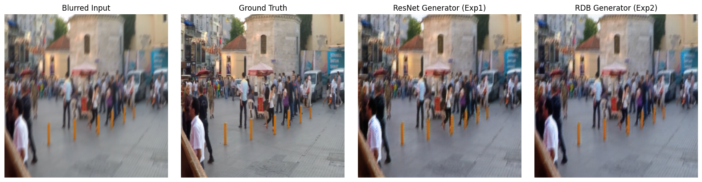
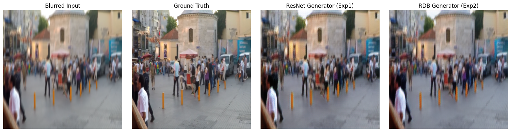
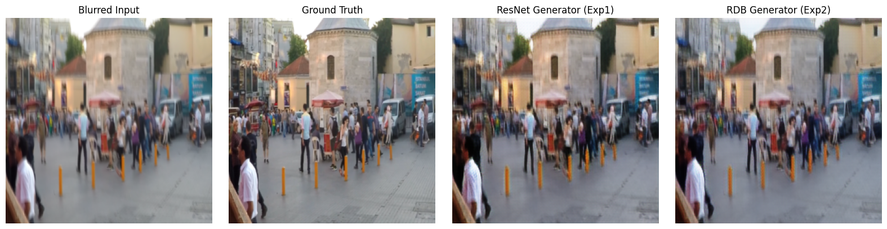

# Image Deblurring Using Generative Adversarial Networks

A master's-level **Computer Vision** project comparing two generator architectures for GAN-based motion deblurring: a **ResNet residual-block generator** and a **Residual Dense Block (RDB) generator**.

Developed by **Prasad Belsare and Nakul Magotra** for **CSCI-4625 Computer Vision** at the University of Colorado Denver (December 2025).

## Overview

Motion blur can obscure fine image details and reduce the quality of downstream computer vision tasks. This project trains conditional adversarial models to reconstruct sharper RGB images using paired blurry/sharp examples from the [GoPro Large dataset](https://huggingface.co/datasets/snah/GOPRO_Large).

Both experiments use a PatchGAN-style discriminator and a weighted combination of adversarial, pixel L1, and VGG-19 perceptual losses. The generator architecture is varied while keeping the data pipeline and other main training settings fixed.

## Results

**Latest notebook run (saved outputs in `CV_Project.ipynb`)**

| Generator | PSNR (dB) ↑ | SSIM ↑ |
| --- | ---: | ---: |
| ResNet residual blocks | 23.555 | 0.8327 |
| Residual Dense Blocks (RDB) | **24.675** | **0.8484** |

The RDB generator improved PSNR by **1.120 dB** and SSIM by **0.0157** in the saved notebook run.

**Original submitted project report:** ResNet 23.216 dB / 0.8317 SSIM versus RDB 24.616 dB / 0.8468 SSIM. These values come from a separate documented run; see [`Project_Report.pdf`](Project_Report.pdf). Results vary across runs.

### Example reconstructions





## Tech stack

- **Language:** Python
- **Deep learning:** PyTorch, torchvision
- **Image processing:** Pillow, NumPy, scikit-image
- **Visualization:** Matplotlib
- **Environment:** Jupyter / Google Colab; GPU recommended

## Repository contents

- `CV_Project.ipynb` — model definitions, GoPro image pairing, training, evaluation and saved results
- `Project_Report.pdf` — submitted academic project report and background research
- `assets/` — image comparisons exported from the notebook's saved outputs
- `requirements.txt` — Python dependencies
- `.gitignore` — excludes dataset files and model checkpoints

## Reproduce the experiments

1. Open `CV_Project.ipynb` in **Google Colab** (recommended) or a Jupyter environment with access to a GPU.
2. Install Python dependencies if needed:

   ```bash
   pip install -r requirements.txt
   ```

3. Run the cells in order. Section 2.1 looks for an existing dataset and otherwise downloads `GOPRO_Large.zip` from Hugging Face (approximately **9.5 GB compressed**). Allow extra storage for extraction.
4. The dataset loader expects:

   ```text
   <data_root>/train/<sequence>/blur/*.png
   <data_root>/train/<sequence>/sharp/*.png
   <data_root>/test/<sequence>/blur/*.png
   <data_root>/test/<sequence>/sharp/*.png
   ```

   The notebook detects whether `train/` and `test/` were extracted inside `GOPRO_Large/` or into the working directory (as happened in Colab).
5. Run both generator experiments, evaluation, and side-by-side visualization. The configured training defaults are **256 × 256** images, batch size **4**, and **5 epochs** per model.

**Note:** The notebook calls the GoPro `test` split its *validation* set for evaluation; no separate validation split is configured. Re-running training may produce different PSNR/SSIM results. Trained `.pth` checkpoints and the full dataset are not tracked in GitHub.

## Project limitations

GAN-based reconstruction can invent plausible textures when the blur is extreme; sharp-looking outputs are not always faithful to the ground truth. Further work could evaluate robustness to noise, compression, and real-world motion blur.

## References

- Kupyn et al., *DeblurGAN: Blind Motion Deblurring Using Conditional Adversarial Networks*, CVPR 2018
- Kupyn et al., *DeblurGAN-v2: Deblurring (Orders-of-Magnitude) Faster and Better*, ICCV 2019
- [GoPro Large dataset (Hugging Face)](https://huggingface.co/datasets/snah/GOPRO_Large)
